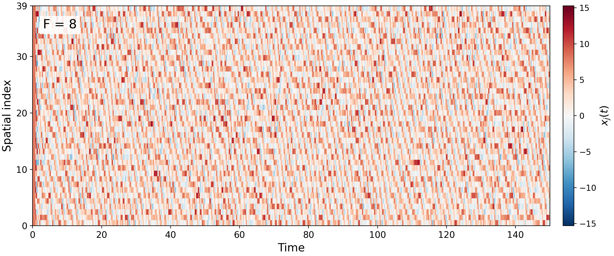
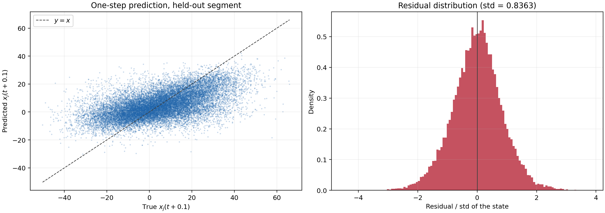
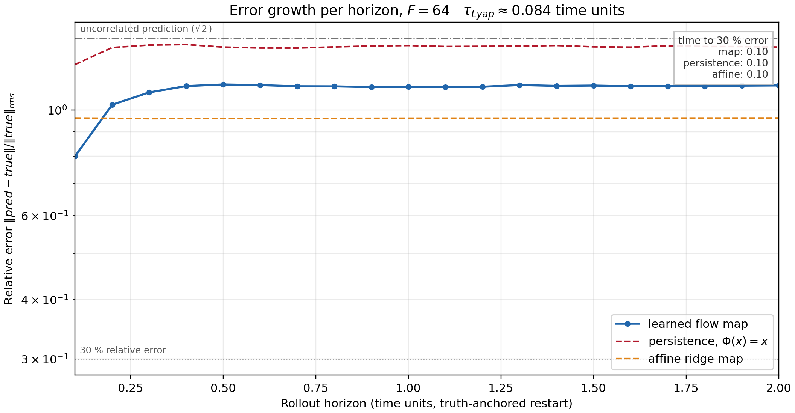
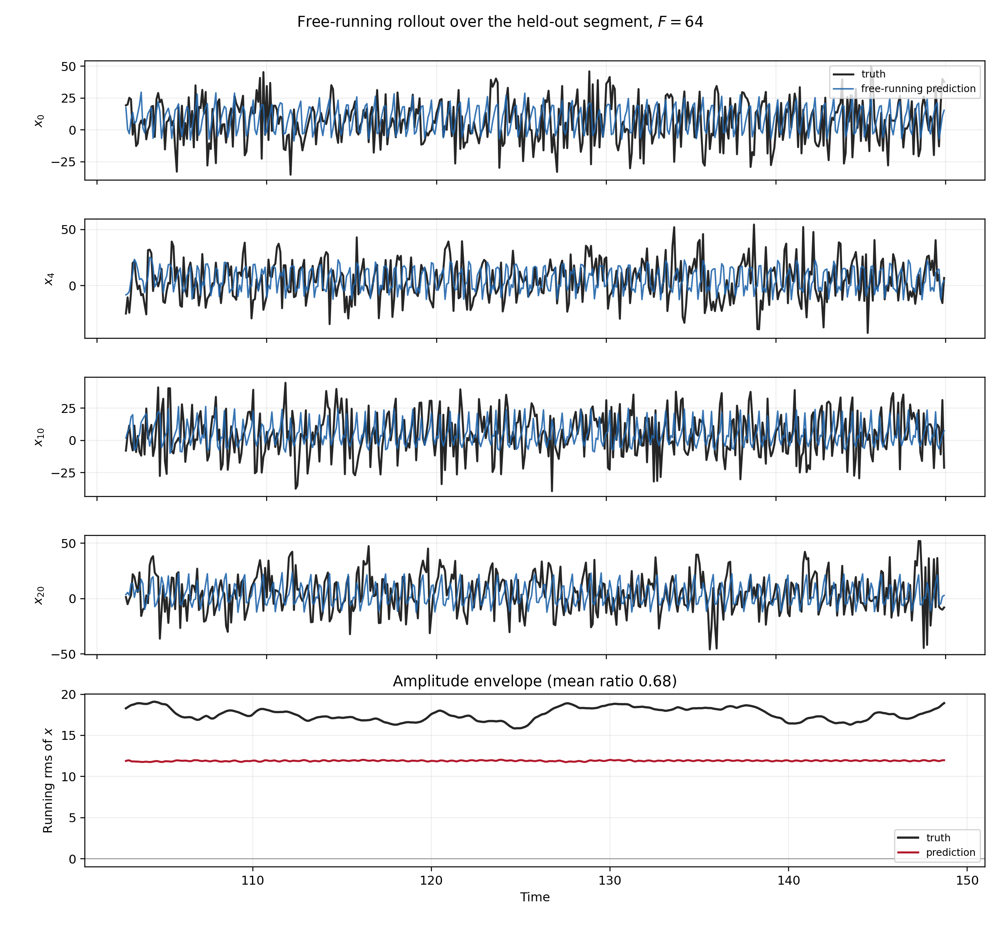
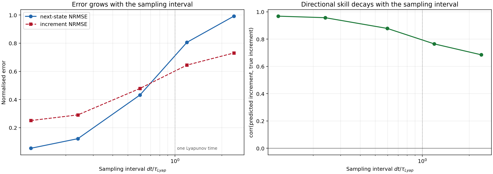

# Lorenz-96 with RK4

This project solves the 40-dimensional Lorenz-96 system

```math
\dot{x}_j=(x_{j+1}-x_{j-2})x_{j-1}-x_j+F,
\qquad x_{j+40}=x_j,
```

using the classical fixed-step fourth-order Runge-Kutta method.



## Reproducible run

The committed result uses:

- `N = 40`
- `F = 8` and `F = 64` (same numerical settings)
- `t in [0, 150]` (extended so both datasets have ESS >= 200)
- `dt = 0.01`
- `seed = 20260917`
- `x_j(0) = F + epsilon_j`, where `epsilon_j ~ Normal(0, 0.01^2)`

The fixed seed makes the randomly perturbed initial state reproducible. The
exact values are stored in `results/initial_condition_F8.csv` and
`results/initial_condition_F64.csv`.

## Run

```bash
python -m pip install -r requirements.txt
python solve_lorenz96.py --forcing 8
python solve_lorenz96.py --forcing 64
```

Optional parameters:

```bash
python solve_lorenz96.py --forcing 8 --n 40 --t-end 150 --dt 0.01 --seed 20260917
```

Outputs:

- `results/lorenz96_rk4_F8.png` and `results/lorenz96_rk4_F64.png`: space-time heatmaps
- `results/lorenz96_rk4_F8.csv` and `results/lorenz96_rk4_F64.csv`: time and all 40 state components
- `results/initial_condition_F8.csv` and `results/initial_condition_F64.csv`: initial states

## Decorrelation and effective sample size

Run the analysis after generating both trajectories:

```bash
python analyze_correlations.py
```

The analysis discards the initial `t < 5` transient, computes a time ACF for
each of the 40 spatial components, applies the Ljung–Box test at lag 50, and
estimates the integrated autocorrelation time with Geyer's initial positive
sequence (IPS):

```text
Gamma_k = rho_(2k) + rho_(2k+1)
tau_int = -1 + 2 * sum(Gamma_k)
```

The sum stops before the first non-positive `Gamma_k`. For each component,

```text
ESS = n_samples / tau_int
```

Results are written to `results/correlation/`, including per-component CSV
files, ACF arrays, a comparison figure, and `summary.txt`. A Ljung–Box
`p > 0.05` means the test does not reject the null hypothesis of no temporal
autocorrelation through lag 50; it is not proof that the samples are exactly
independent.

For the final run (`n_samples = 14501` per component after burn-in):

| Forcing | Median ESS | ESS range | Median integrated autocorrelation time | Ljung–Box Q(50) p > 0.05 |
|---:|---:|---:|---:|---:|
| 8 | 306.90 | 281.69–337.26 | 0.4725 | 40 / 40 |
| 64 | 1171.29 | 980.15–1298.53 | 0.1238 | 40 / 40 |

The higher forcing case decorrelates faster in this simulation, so its
effective sample size is larger despite the same raw number of time points.

### Ljung–Box confidence and interpretation

The test uses `alpha = 0.05`, i.e. a 95% confidence level. Its null hypothesis
is that the autocorrelations through lag 50 are jointly zero. All 40 components
for both forcing values reject that null. The reported p-values are shown as
`0.000e+00` because they underflow IEEE double precision; they mean “far below
machine precision”, not an exactly zero probability.

The relatively high temporal autocorrelation is expected here. The integrator
samples a smooth deterministic ODE every `dt = 0.01`, so adjacent states differ
only slightly. The Lorenz–96 nearest-neighbour coupling transports structures
between spatial sites, while the `-x_j` term damps them on an O(1) time scale.
At `F=8`, coherent waves persist longer and the estimated correlation time is
larger. At `F=64`, the stronger nonlinear activity creates faster fluctuations,
so the correlation time is shorter and the ESS is larger. A small Ljung–Box
p-value detects any residual serial dependence; it does not by itself quantify
how many effectively independent samples remain, which is why the Geyer ESS is
reported alongside it.

## Test

```bash
python -m unittest -v
```

The tests verify periodic indexing, preservation of the constant equilibrium,
and the expected fourth-order convergence on a reduced problem with a known
exact solution.

## Energy correlations for F=64

The energy analysis uses

```text
E_j(t) = x_j(t)^2 / 2
```

after the same `t < 5` burn-in. Run:

```bash
python analyze_energy_correlations.py
```

This writes `results/energy_correlation/`:

- `energy_F64.csv` and `energy_space_time_F64.png`: energy samples and the space-time energy field.
- `energy_temporal_acf_F64.png`: temporal ACF, averaged over spatial components with the component range.
- `energy_spatial_acf_definitions_F64.png`: three periodic spatial ACF definitions. `snapshot_centered` centers each time snapshot over space; `global_centered` uses one global mean and variance; `component_anomaly` removes each component's temporal mean before forming spatial covariance.
- `energy_spacetime_acf_3d_F64.png`: three-dimensional ACF surface using the global-centered periodic correlation `C(delta t, delta j)`, averaged over all valid time pairs and spatial shifts.
- CSV files containing the plotted numerical values.

## Fourier representation, mode ACF and mode energy (F=64)

The spatial DFT of the state is

```text
xhat_k(t) = N^(-1/2) * sum_j x_j(t) exp(-2 pi i (j - 1) k / N),   k = 0 .. N-1
```

with `N = 40`. Because `x_j` is real, the coefficients satisfy the conjugate
symmetry `xhat_(N-k) = conj(xhat_k)`, so only `k = 0 .. N/2` are independent:
mode `0` and the Nyquist mode `k = N/2 = 20` are real, and the `k = 1 .. 19` are
genuine complex series. Every mode therefore contributes a complex-valued time
series `{xhat_k(t)}`.

Run:

```bash
python analyze_fourier_modes.py
```

The temporal autocorrelation of a mode uses the Hermitian convention

```text
rho_k(tau) = E[conj(xhat_k(t)) xhat_k(t + tau)] / E[|xhat_k(t)|^2]
```

with the temporal mean removed, so `rho_k` is complex with
`rho_k(-tau) = conj(rho_k(tau))` and `rho_k(0) = 1`. `Re rho_k` is itself a real
autocorrelation sequence (it is the variance-weighted average of the ACFs of
`Re xhat_k` and `Im xhat_k`), so Geyer's initial-positive sequence is applied to
it to obtain the integrated time.

Energy is assigned per mode. Since the transform above is unitary, Parseval reads
`sum_k |xhat_k|^2 = ||x||^2`, and with `dof_k = 1` for `k = 0, N/2` and
`dof_k = 2` otherwise,

```text
E_k(t) = dof_k * |xhat_k(t)|^2 / 2 ,     sum_k E_k(t) = ||x(t)||^2 / 2
```

The reported share is `mean_t E_k / mean_t ||x||^2 / 2`, which sums to 100% by
construction. Run with `--self-check` to compare the FFT autocorrelation against
a direct `O(n * lag)` loop.

This writes `results/fourier_modes/`:

- `fourier_energy_spectrum_F64.png`: energy share per mode, log-scale mode energy and the cumulative share.
- `fourier_wavenumber_time_F64.png`: mode energy density `10 log10(E_k / Ebar)` as a function of time and wavenumber.
- `fourier_acf_F64.png`: mode ACF magnitude (log scale), its heat map, and the integrated decorrelation time per mode.
- `fourier_acf_real_imag_F64.png`: real and imaginary parts of the ACF for `k = 0, 1, 5, 10, 20`.
- `mode_amplitudes_F64.csv`, `mode_real_imag_F64.csv`, `mode_energy_F64.csv`: the mode series and their energies.
- `fourier_acf_curves_F64.csv`, `fourier_mode_summary_F64.csv`, `summary.txt`: ACF curves and the per-mode table.

For the committed run (`n_samples = 14501` per mode, `t < 5` discarded):

| Quantity | Value |
|---|---|
| Parseval check `max abs(sum_k |xhat_k|^2 - ||x||^2)` | 1.5e-08 |
| Conjugate-symmetry check `max abs(xhat_(N-k) - conj(xhat_k))` | 2.2e-14 |
| Energy-partition check `max abs(sum_k E_k - ||x||^2/2)` | 5.5e-12 |
| Time-averaged total energy `||x||^2 / 2` | 6265.96 |
| Largest mode share | `k = 0`, 9.59% |
| Energy-containing band | `k = 4 .. 13`, 55.7% |
| Smallest mode share | `k = 20`, 1.42% |
| Median / min / max `tau_int` | 0.1217 / 0.0916 / 0.1627 |

The spectrum is red: the largest share belongs to the spatial mean (`k = 0`)
and the share decreases towards the Nyquist mode. Per degree of freedom the same
ordering holds, so the large scales carry more energy than the small ones. The
integrated decorrelation time follows the opposite ordering overall, from
`0.1627` at `k = 0` down to `0.0916` at `k = 19`, with a secondary maximum near
`k = 10 .. 13` that coincides with the energy-containing band.

## Neural flow map, method 1: direct next-state regression (F=64)

A *flow map* is the one-step propagator of the ODE. Resampling the `dt = 0.01`
record on the requested `dt = 0.1` grid and pairing consecutive snapshots gives
supervised pairs `(x(t), x(t + 0.1))`, and the task is to learn
`Phi_dt` with a neural network.

Four regression strategies share one pipeline (`flowmap_data.TargetCodec`), so
that the data, the network and the metrics are identical across them:

| Mode | Network regresses |
|---|---|
| `direct` | `z(t + dt)` — implemented here |
| `delta` | `z(t + dt) - z(t)` |
| `residual_linear` | residual against a ridge-fit affine map `A z + b` |
| `residual_linearized` | residual against the exact solution of `x' = -x + F`, i.e. `F + (x - F) exp(-dt)` |

### Protocol

```bash
python train_flowmap.py                 # method 1, the committed run
python train_flowmap.py --self-check    # fast consistency checks
python scan_dt_flowmap.py               # sampling-interval sweep
```

- Burn-in: `t < 5` is discarded, because the solver starts near the unstable
  equilibrium `x_j = F` and that spin-up is not on the attractor.
- Split: chronological, **first 2/3 train / last 1/3 test**. The transition that
  straddles the boundary is dropped, so no training target lies inside the test
  segment. 966 training pairs, 483 test pairs.
- Standardisation: `z = (x - mu) / sigma` with `mu`, `sigma` taken from the
  training split only. Necessary: the state amplitude is `O(10^2)`.
- Network: `40 -> [Linear + tanh] x 2 (80 units) -> Linear -> 40`,
  **13 000 trainable parameters**.
- Optimiser: AdamW, `lr = 3e-3` cosine-annealed to `3e-6`, batch 512,
  1500 epochs, gradient clipping at norm 10.
- Augmentation: Lorenz-96 is invariant under cyclic shifts of the index `j`, so
  `Phi(roll(x, m)) = roll(Phi(x), m)`. Expanding the training pairs over all 40
  offsets gives 38 640 pairs at zero measurement cost. This is a symmetry of the
  governing equations, not leakage.

### Result (committed run)

| Metric | Value |
|---|---|
| One-step NRMSE, train | 0.7967 |
| One-step NRMSE, test | **0.8035** |
| One-step NRMSE, persistence `Phi(x) = x` | 1.2508 |
| One-step NRMSE, affine ridge map | 0.9653 |
| Skill relative to persistence | 35.8 % |
| Skill relative to affine ridge | 16.8 % |
| Increment NRMSE | 0.6424 |
| `corr(predicted increment, true increment)` | **0.7664** |
| Time to 30 % error (map / persistence / affine) | 0.10 / 0.10 / 0.10 |
| Free-running NRMSE over the test segment | 1.1222 |
| Rollout rms / truth rms | 0.6752 |
| Spectrum correlation (log `E_k`, `k >= 1`) | 0.4251 |
| Largest Lyapunov exponent | 11.89 per time unit |
| Lyapunov time | **0.084 time units** |

Train and test NRMSE agree to four decimals (0.7967 vs 0.8035), so the residual
error is **not** overfitting: the network is at the capacity limit of what this
representation can fit.





### Why the one-step error is as large as it is

Three facts, each measured rather than assumed:

1. **The sampling interval is coarser than a Lyapunov time.** `lambda_max =
   11.89` gives `tau_Lyap = 0.084`, so `dt = 0.1` spans `1.19 tau_Lyap`. The true
   one-step map expands an infinitesimal separation by `exp(0.1 * 11.89) ~ 3.3`.
   Two states that look close on the attractor are already far apart one step
   later, which is what makes the map hard to interpolate.
2. **The attractor is almost full-dimensional.** PCA on the resampled record
   gives a participation ratio of **37.3 out of 40**; the first 20 principal
   components explain only 64 % of the variance. 38 640 training points in a
   40-dimensional, nearly isotropic cloud is extremely sparse — the nearest
   neighbour of a test state is farther away than the attractor diameter.
3. **Only chaos is not the bottleneck.** A perfect model started `1e-8` away
   from the truth still predicts to 30 % for **1.69 time units**, because
   `ln(0.3 * rms / 1e-8) / lambda_max = 1.69`. The learned map has an *effective*
   initial error of `0.804 * 17.65 = 14.18`, which is already larger than the
   30 % threshold itself (`0.3 * 17.65 = 5.30`). Hence a useful horizon of zero.
   The gap between 1.69 and 0 is entirely approximation error, not chaos.

`scan_dt_flowmap.py` isolates the first effect at fixed compute (80 000 gradient
steps per configuration):



| `dt` | `dt / tau_Lyap` | Training pairs | Next-state NRMSE | Increment NRMSE | Increment corr. |
|---:|---:|---:|---:|---:|---:|
| 0.01 | 0.12 | 386 640 | **0.0538** | 0.2507 | 0.9681 |
| 0.02 | 0.24 | 193 320 | 0.1219 | 0.2907 | 0.9568 |
| 0.05 | 0.60 | 77 320 | 0.4319 | 0.4786 | 0.8781 |
| 0.10 | 1.19 | 38 640 | 0.8060 | 0.6444 | 0.7647 |
| 0.20 | 2.39 | 19 320 | 0.9919 | 0.7304 | 0.6849 |

The same network that reaches 80.6 % error at `dt = 0.1` reaches **5.4 %** at
`dt = 0.01`. The architecture is not the limitation; the requested sampling
interval is. Any claim about a neural flow map for this system has to state the
interval it is trained on.

### Two behaviours worth knowing

- **Amplitude contraction.** A regression network trained on one-step targets
  shrinks towards the conditional mean when uncertain, and iterating that
  shrinkage produces a *smaller* attractor rather than a divergence. The
  free-running rollout keeps oscillating, with rms equal to 0.68 of the truth and
  a mean 1.18 times larger — see the bottom panel of the rollout figure.
- **Spectral distortion.** The reproduced spectrum is 3-10x low and peaks at
  `k = 8` instead of `k = 11`, because the contraction suppresses the energetic
  band more than the large scales.

### Files

- `flowmap_data.py`: resampling, chronological split, the four target codecs.
- `flowmap_model.py`: the MLP and the training loop.
- `train_flowmap.py`: end-to-end run, metrics, figures, `--self-check`.
- `scan_dt_flowmap.py`: sampling-interval sweep at fixed compute.
- `test_flowmap.py`: 16 unit tests, including a finite-difference check of the
  analytic gradient and a check that cyclic shifting commutes with the true flow.
- `results/flowmap/`: figures, `metrics.json`, `summary.txt`, per-epoch history,
  rollout and sweep CSVs, and the trained weights (`flowmap_model_F64.pt`).

