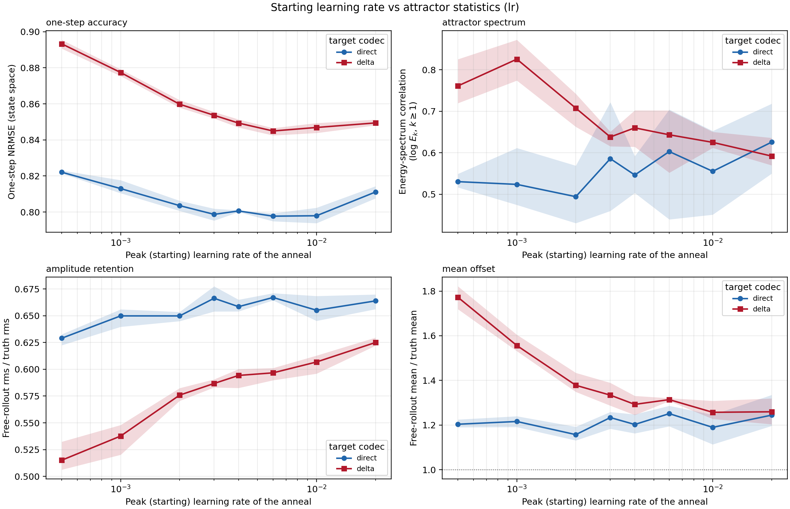
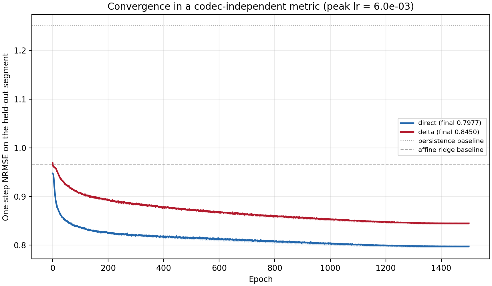
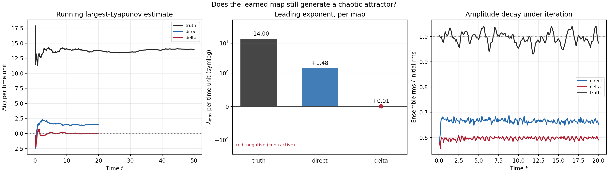
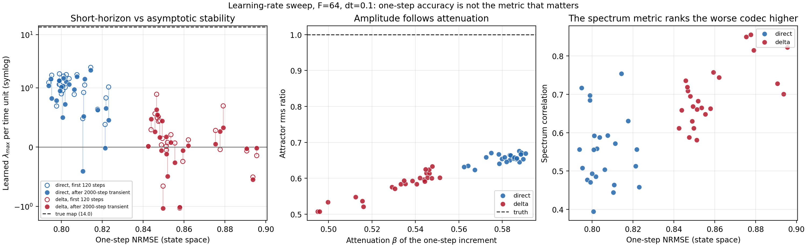
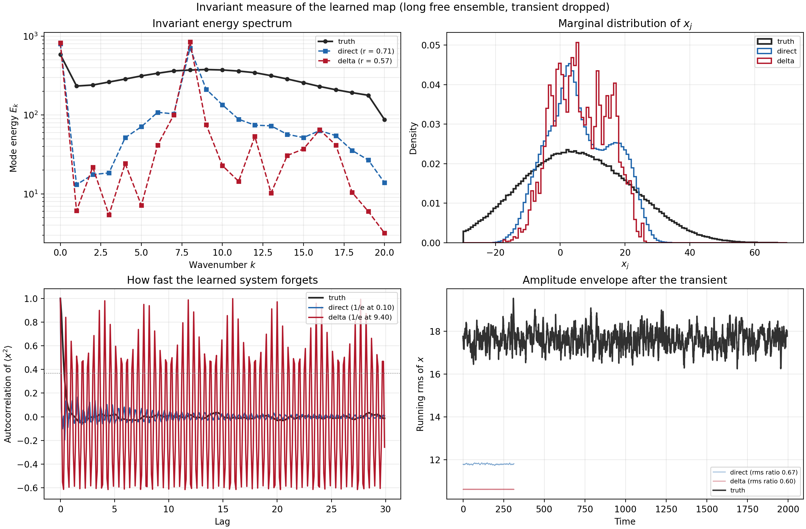
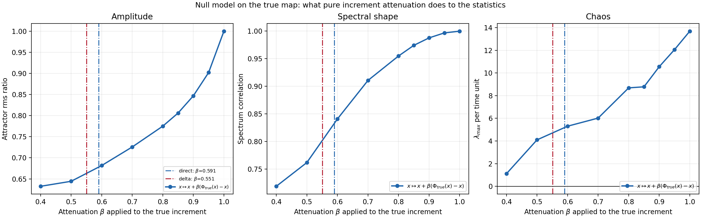
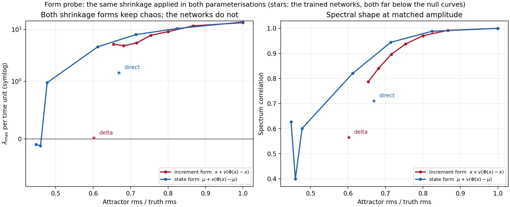
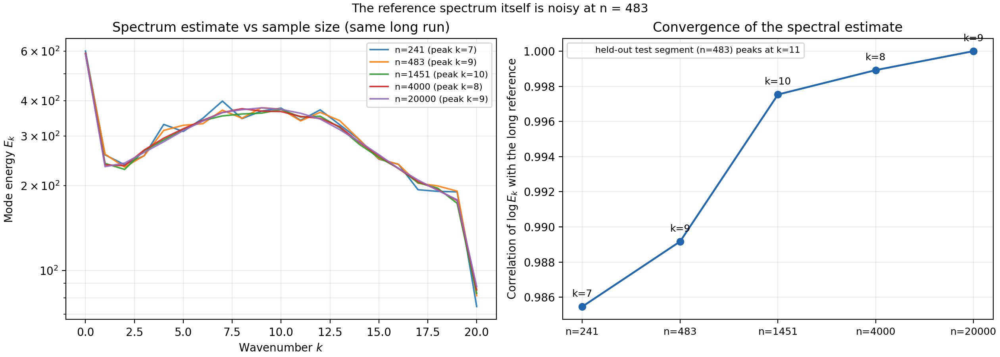

# v3 — 学习率退火扫描 + 为什么"学增量"输给"学下一状态"

> 接手自 `handoff_prompt_lorenz96_flowmap.md`（v2 之后）。本文件只报告本次新增的实验与结论；
> 数据、脚本、图都在仓库里，可复现命令见 §7。共 60 次训练（48 格扫描 + 6 长训练 + 6 恒 lr 对照）。

## 0. 结论速览

1. **退火本身值 ~2.3%，起点学习率的"中段"再值 3%**。同一峰值 lr 6e-3 下，
   cosine 退火的一步 NRMSE 是 0.7977 / 0.8450（direct / delta），恒定 lr 是 0.8176 / 0.8644。
   峰值学习率的最优点在 **6e-3**（direct 0.7977 [0.7949, 0.7993]，delta 0.8450 [0.8425, 0.8466]），
   3e-3…1e-2 是平台，2e-2 与 5e-4 两端都掉。
2. **统计指标极不稳，而且方向可能是反的**。同一设置下 3 个 seed 的一步 NRMSE 只差 0.005，
   而 log 谱相关能在 0.44…0.70 之间摆动（direct 6e-3 的三个 seed）。更糟的是它**系统性奖励坍缩**：
   delta 网格上 `corr(谱相关, rms 比) = −0.91`、`corr(谱相关, 一步 NRMSE) = +0.84`——
   谱相关最高的那次（0.826）恰恰是振幅只剩 0.54、均值漂到 1.56 的那次。
   **v2 笔记里"global 标准化把谱相关从 0.425 提到 0.678"应撤回**：0.678 是 3 个 seed 的最大值，均值 0.586。
3. **"学增量更差"不是估计量问题，是估计器问题**。`dz = z(t+dt) − z(t)` 是已知加性偏移，
   两种编码的估计量逐点等价（§4.1）。码本差距随学习率**单调收缩**（5e-4 的 0.0712 → 2e-2 的 0.0383），
   说明它是收敛速度的差异，不是表示能力。
4. **差距收敛到一个平台，不会消失**。把训练从 1500 拉到 4000 epoch，
   direct 0.7977→0.7926、delta 0.8450→0.8373，差距 0.0473→0.0447（几乎不动）。
   所以 delta 不是"还没练够"，而是**停在更高的地板**上。
5. **缺口 100% 在非线性项**。把增量按 `dz = (Az+b) + n(z)` 分解后，delta 对线性阻尼抓得**更好**
   （linear capture 0.7225 vs 0.7009），对非线性平流抓得**差 30%**（R² 0.1779 vs 0.2558）。
   平流项正是产生拉伸的那一项——这条链在 §4.7 闭合。
6. **一步误差差 6%，迭代 2000 步后是两个不同强度的系统**：真值 λ_max = +14.0（19 个不稳定方向），
   direct +1.48（5 个），delta **+0.02（1 个，即恰好在混沌阈值上）**。
   整张网格上：direct 24 次里 22 次 λ>0（中位 +1.00），delta 24 次里 10 次 λ<0、
   6 次收敛到精确极限环（中位 +0.04）。

## 1. 本次改了什么

| 文件 | 改动 |
|---|---|
| `flowmap_model.py` | 退火调度抽成 `lr_multiplier` / `build_scheduler`：`cosine` / `linear` / `constant`，可选线性 warmup，终值 `final_fraction`。加 `eval_hook`，每个 epoch 记录**码本无关**的指标（解码后的一步 NRMSE、增量相关）。 |
| `train_flowmap.py` | 新增 `--schedule` `--lr-final-frac` `--warmup-frac`；`metrics.json` 记录调度参数；训练历史 CSV 追加 `test_state_nrmse` `test_increment_corr`。 |
| `sweep_lr.py` | 退火扫描驱动器：网格 → 子进程并行 → 汇总 CSV/表/图；含**跨码本可比**的收敛曲线。 |
| `diagnose_codecs.py` | 码本诊断工具箱：一步误差预算（β、线性/非线性分解、按幅度分箱的 β）、QR 全切空间 Lyapunov 谱（**新增 `warm_up`**）、极限环检测、未定常测度、两个零模型探针。 |
| `scan_dynamics.py` | 对整张网格逐个测动力学，产出图 7；**同时记录"短时 λ"与"预热后 λ"**。 |
| `probe_transient.py` | 单模型的暂态长度探针：在不同 warm_up 下测 λ 与最近回归距离（复现 §4.4 的表）。 |
| `test_flowmap.py` | +6 个调度相关单测（端点、单调性、warmup、constant 对照、history 扩展、端到端）。 |

**为什么要加 `eval_hook`**：训练损失活在各码本自己的目标空间里，`direct` 与 `delta` 的 loss 不可比
（两者恰好差一个 `z_input`）。把网络输出解码回物理状态再算 NRMSE，两条学习曲线才能叠在一张图上。

**为什么要加 `warm_up`**：这件事是本次实验中途被数据逼出来的（§4.4）。学到的映射有**很长的混沌暂态**，
从测试初值直接挂切空间量 120 步，测到的是暂态而不是吸引子。

## 2. 实验设置（全程固定，只有列出的量在变）

- 数据 `results/lorenz96_rk4_F64.csv`，RK4 `dt=0.01`，重采样 `stride=10 → dt=0.1`。
- 时间序切分 2/3 训练 / 1/3 测试，burn-in 5，跨边界对丢弃（无泄漏）：966 / 483 对。
- global 标准化（40 个分量池化一个 μ=4.9235、σ=17.0340，仅用训练段估计）。
- 网络 40→[80 tanh]×2→40，13 000 参数；AdamW，batch 512，1500 epoch，grad clip 10，40× 循环移位增广（38 640 对）。
- **主扫描**：峰值 lr ∈ {5e-4, 1e-3, 2e-3, 3e-3, 4e-3, 6e-3, 1e-2, 2e-2} × 码本 {direct, delta} × seed {0,1,2} = **48 次**。
- **对照 A（长训练）**：lr 6e-3、4000 epoch、两码本 × 3 seed = 6 次。
- **对照 B（恒 lr）**：lr 6e-3 不退火（`--schedule constant`）、1500 epoch、两码本 × 3 seed = 6 次。

## 3. 学习率退火扫描



3 个 seed 的均值，方括号是 [min, max]：

| 峰值 lr | direct 一步 | delta 一步 | 差 | direct 谱相关 | delta 谱相关 | direct rms | delta rms |
|---|---|---|---|---|---|---|---|
| 5e-4 | 0.8221 [0.8214, 0.8231] | 0.8933 [0.8907, 0.8956] | 0.0712 | 0.530 [0.517, 0.549] | 0.761 [0.720, 0.825] | 0.629 | 0.515 |
| 1e-3 | 0.8130 [0.8105, 0.8177] | 0.8774 [0.8754, 0.8792] | 0.0644 | 0.524 [0.474, 0.612] | 0.826 [0.774, 0.872] | 0.650 | 0.538 |
| 2e-3 | 0.8036 [0.8006, 0.8063] | 0.8598 [0.8579, 0.8621] | 0.0562 | 0.494 [0.430, 0.569] | 0.708 [0.663, 0.742] | 0.650 | 0.576 |
| 3e-3 | 0.7987 [0.7953, 0.8019] | 0.8537 [0.8519, 0.8555] | 0.0549 | 0.586 [0.460, 0.722] | 0.638 [0.616, 0.651] | 0.666 | 0.587 |
| 4e-3 | 0.8006 [0.8000, 0.8010] | 0.8493 [0.8469, 0.8514] | 0.0487 | 0.547 [0.503, 0.592] | 0.660 [0.614, 0.702] | 0.659 | 0.594 |
| **6e-3** | **0.7977 [0.7949, 0.7993]** | **0.8450 [0.8425, 0.8466]** | 0.0473 | 0.603 [0.439, 0.704] | 0.643 [0.552, 0.702] | 0.667 | 0.597 |
| 1e-2 | 0.7979 [0.7938, 0.8024] | 0.8469 [0.8439, 0.8494] | 0.0490 | 0.555 [0.451, 0.653] | 0.625 [0.612, 0.650] | 0.655 | 0.607 |
| 2e-2 | 0.8111 [0.8076, 0.8143] | 0.8494 [0.8481, 0.8513] | 0.0383 | 0.626 [0.550, 0.718] | 0.592 [0.570, 0.636] | 0.664 | 0.625 |

四个读法：

1. **一步精度**：direct 从 5e-4 的 0.8221 降到 6e-3 的 0.7977（−3.0%），3e-3 起进入平台，
   2e-2 反弹到 0.8111。delta 同样的形状但更陡、更右：0.8933→0.8450（−5.4%），最优点也在 6e-3。
   **delta 对学习率更敏感（5.4% vs 3.0%），最优点更靠右**——本身就是"它的优化更难"的第一个信号。
2. **谱相关**：误差棒（seed 极差）比学习率效应还大。direct 在 0.49–0.63 之间无趋势；
   delta 从 5e-4 的 0.761 冲到 1e-3 的 **0.826**，然后单调掉到 2e-2 的 0.592。
   这个"冲高"不是变好，而是**坍缩**：同一行 rms 只有 0.538，均值 1.556。
   把整张网格拉平算相关：delta 的 `corr(谱相关, rms 比) = −0.91`、
   `corr(谱相关, 一步 NRMSE) = +0.84`（direct 分别是 +0.69 与 −0.25）。
3. **振幅**：direct 稳在 0.63–0.67 且与 lr 几乎无关；delta 从 0.515 单调爬到 0.625，
   追到 2e-2 仍差 direct 一截。振幅损失是"回归到条件均值"的结构性后果，调参解决不了。
4. **码本差距单调收缩**：0.0712→0.0383（log lr 上接近线性）。若差距是表示能力问题，
   它不该随优化强度变化；它随优化强度单调缩小，说明是**收敛速度**。

### 3.1 退火 vs 恒定 lr（对照 B）

| 设置（lr 6e-3，1500 ep，3 seed） | direct 一步 | delta 一步 | direct 增量 r | delta 增量 r | direct 谱相关 | delta 谱相关 |
|---|---|---|---|---|---|---|
| cosine 退火到 6e-6 | **0.7977** | **0.8450** | **0.7703** | **0.7374** | 0.603 | 0.643 |
| 恒定 6e-3 | 0.8176 | 0.8644 | 0.7569 | 0.7229 | **0.757** | **0.788** |

- 退火把一步 NRMSE 拉低 0.020（2.4% / 2.2%），把增量相关抬高 0.013–0.015。**退火是必要的。**
- 但恒 lr 的谱相关反而更高（0.757 vs 0.603）。又一次同一个陷阱：**这个指标和精度不同向**。
- 恒 lr 的 λ_max 也更高（direct +1.6…+2.8，delta +0.6…+1.6），即"更混沌但更不准"。
  退火把两个地图都往弱混沌推。**"让一步精度最好"和"让吸引子最像"不是同一件事**。

### 3.2 收敛曲线（跨码本可比）



`test_state_nrmse`（解码回物理状态后的一步 NRMSE）每个 epoch 记一次，3 seed 均值 + 极差带：

- delta 从第 1 个 epoch 就在 direct 上方（0.96 vs 0.90），全程没追上，1500 epoch 时是 0.8450 vs 0.7977。
- 两条曲线在 1500 epoch 都还没压平（末段斜率仍在 −1e-5/epoch 量级），所以"没练够"这个解释必须用
  4000 epoch 的对照来排除——见 §4.3，结论是**排除掉了**。
- 两条基线：persistence 1.2508、affine ridge 0.9653。两个网络都在 affine 之上，说明学到的是非线性平流。

## 4. 为什么学增量输给学下一状态

### 4.1 两种编码的估计量是同一个

标准化后 `z = (x−μ)/σ`，`decode_direct(z, f) = μ + σf`，`decode_delta(z, g) = μ + σ(z + g)`。
若 `f = z + g`，两者**逐点相同**。而 MLP 函数类对"加一个恒等映射"只差一个平移，
在这个容量下（13 000 参数，逼近同一光滑映射）没有任何理由认为其中一个*表示能力*更强。

所以：**任何测到的差异都是估计器（优化轨迹 + 归纳偏置）的差异。**
这一点决定了后面所有实验的设计——必须去看"两个网络各自学到了什么"，而不是"哪个目标更难"。

### 4.2 误差预算：缺口全部落在非线性项

把真实增量按线性最小二乘分解

```
dz = (A z + b) + n(z),      A, b 由训练段岭回归得到
```

再对网络预测做同样分解，分别衡量"线性部分抓到了多少"（linear capture）与"非线性残差解释了多大方差"（R²）：

| 量（lr 6e-3，seed 1） | direct | delta | 差 |
|---|---|---|---|
| 一步 NRMSE（物理状态） | **0.7949** | 0.8425 | +6.0% |
| 衰减斜率 β = ⟨dẑ, dz⟩/⟨dz, dz⟩ | 0.5907 | 0.5512 | −0.040 |
| 增量 R² | 0.5961 | 0.5463 | −0.050 |
| 增量相关 | 0.7721 | 0.7392 | −0.033 |
| 偏差占 MSE 的比例 | 0.22% | 0.26% | — |
| **线性部分 capture** | 0.7009 | **0.7225** | **+0.022** |
| **非线性部分 R²** | **0.2558** | 0.1779 | **−0.078 (−30%)** |

三件事同时成立：

1. **偏差可以忽略**（0.2%），缺口是**离散度**，不是系统偏移。
2. **线性部分**（`−x dt` 的阻尼）delta 抓得**更好**——这部分是"容易"的。
3. **非线性部分**（`x_{j−1}(x_{j+1}−x_{j−2}) dt` 的平流）delta 差 30%——缺口全在这里。

为什么增量目标会把容量挤到线性项上：**`dz` 的方差比 `z(t+dt)` 还大 72%**（1.718 倍，
rms 22.3 vs 17.7），而且它的方差被线性阻尼主导（`corr(z, dz) = −0.655`，`dz` 超额峰度 +0.98）；
而 `z(t+dt)` 与 `z` 几乎正交（`corr = +0.141`）。MSE 面对一个方差更大的、主要由线性项构成的靶子，
梯度自然先满足它；direct 从一开始就没有"大线性项"可讨好，容量被逼着去拟合平流。
**平流项正是产生正 Lyapunov 指数的那一项**——这就把"目标编码"和"统计指标"连起来了。

### 4.3 长训练对照：差距不收敛（对照 A）

1500 → 4000 epoch（同样 lr 6e-3、cosine、3 seed）：

| | direct | delta | 差距 |
|---|---|---|---|
| 1500 epoch | 0.7977 | 0.8450 | 0.0473 |
| 4000 epoch | 0.7926 | 0.8373 | 0.0447 |
| 改善 | −0.0051 | −0.0077 | −0.0026 |

训练量翻了 2.7 倍，差距只缩了 5%。**delta 不是更慢，而是停在更高的地板上。**
（附带：delta 的均值漂移在这 4000 epoch 里从 1.314 收敛到 1.238，与 direct 的 1.239 一致——
说明"均值偏移"确实是没练够，而"一步精度地板"不是。）

### 4.4 迭代后果：λ 从 +14 掉到 +1.5 与 +0.02



用 QR 重正化在**完整 40 维切空间**上测 Lyapunov 谱（不是单向量 Benettin——
学到的映射雅可比高度非正态，单向量会长时间停在收缩子空间里给出错误符号，这次就踩到了）：

| 映射（lr 6e-3，seed 1） | λ_max / 时间单位 | 不稳定方向 | 雅可比 σ_max / 谱半径 | 最近回归距离 |
|---|---|---|---|---|
| 真值 RK4 @ dt=0.1 | **+13.997** | 19 | 25.5 / 3.90 | 1.2e+02 |
| direct | **+1.478** | 5 | 3.71 / 1.58 | 1.9e+01 |
| delta | **+0.015** | 1 | 2.62 / 1.45 | 7.9e-02 |

（"最近回归距离"= 两万步内轨道回到过去某点的最近距离，用的是同一个 warm_up=20000 的口径：
真值 117、direct 19、delta 0.08。）

**这里有一个中途发现的坑，值得单独记一笔**：最初从测试初值直接挂切空间量 200 步，
某些映射给出正 λ，但它们迭代两万步后收敛到**精确极限环**（回归距离 3e-13）。
也就是说学到的地图有**很长的混沌暂态**，短时 λ 测的是暂态。
所以后来所有 λ 都在 `warm_up` 之后再量，两个数字都记进 CSV（`lambda_transient` / `lambda_max`）：

| 预热步数 | 0 | 2 000 | 8 000 | 20 000 |
|---|---|---|---|---|
| direct λ_max | +1.465 (6) | +1.478 (5) | +1.283 (5) | +1.292 (5) |
| delta λ_max | −0.012 (0) | +0.015 (1) | −0.001 (0) | −0.092 (0) |

结论对这两个模型是稳的：**direct 稳稳地弱混沌（λ≈+1.3，5 个不稳定方向），
delta 骑在阈值上（λ 在 ±0.1 内摆动，0–1 个不稳定方向）**。
"最近回归距离"给出更锐利的对比：direct 两万步内最近也只回到 19（真值 117），
delta 已经回到 **0.08**——它的轨道**几乎**是周期性的。

单个 seed 的 λ 会骗人，所以整张网格都测了（图 7）：



| 24 次训练（每个码本） | direct | delta |
|---|---|---|
| λ_max 中位（预热 2000 后） | **+1.00** | **+0.04** |
| λ_max 范围 | −0.41 … +2.15 | −1.09 … +0.63 |
| λ_max < 0 的次数 | 2 / 24 | **10 / 24** |
| 精确极限环 | 1 / 24 | **6 / 24** |
| 不稳定方向数（中位） | 3 | 1 |
| λ_max（只看前 120 步，中位） | +1.10（24/24 为正） | +0.07（并非全为正） |

**同一个 6% 的一步误差差，落在"混沌阈值"的两侧。** 而阈值哪一侧不是运气：
delta 的 λ 分布整体被压到 0 附近，一半的次数直接掉下去；direct 没有一次真正掉下去。

### 4.5 不变量测度：差异是同一个定性跳跃的后果



长集合 rollout（16 个初值 × 4000 步，丢掉前 800 步）后的统计量，与 20 000 样本的真值参考比：

| 量 | 真值 | direct | delta |
|---|---|---|---|
| rms 比 | 1.000 | 0.669 | 0.602 |
| 方差比 | 1.000 | 0.346 | 0.249 |
| 均值比 | 1.000 | 1.296 | 1.317 |
| 谱相关（log E_k, k≥1） | 1.000 | 0.711 | 0.565 |
| 谱峰 | 9 | 8 | 8 |
| `⟨x²⟩` 自相关 1/e 时间 | 0.40 | 0.10 | **9.40** |
| 尾部展开比 | 1.000 | 0.576 | 0.488 |
| 超额峰度 | −0.217 | −0.794 | −0.834 |

- **振幅**：方差只剩 35% / 25%，谱峰整体偏低（k=8）。
- **自相关**：direct 0.10（比真值还快，"忘得更快"），delta **9.40 且永不衰减**——周期信号的指纹。
- **分布形状**：两个网络都更平（峰度 −0.79 / −0.83），边缘分布被压在 [5,25]（图 4 右上），
  而真值铺到 [−30, 60]。这就是"只复现条件均值"的直接后果。

### 4.6 零模型：纯"衰减"和"换形式"都解释不了

两个受控探针，都不用网络，直接作用在真值映射上：

**(a) 只衰减增量** `x ↦ x + β(Φ(x) − x)`，β 从 1 扫到 0.4。



| β | 1.00 | 0.80 | 0.60 | 0.55 | 0.50 | 0.40 |
|---|---|---|---|---|---|---|
| λ_max | +13.69 | +8.69 | +5.30 | ~+4.1 | +4.10 | +1.11 |
| rms 比 | 0.999 | 0.775 | 0.682 | ~0.66 | 0.644 | 0.632 |

**振幅确实由 β 定量决定**（β=0.60 时 rms 0.682，正好落在两个网络的 0.60–0.67 之间），
但**同样振幅下 λ 还在 +4…+5**——纯衰减杀不掉混沌（要 β≤0.4 才勉强压到 +1）。

**(b) 同一种收缩、两种映射形式**：`x ↦ x + v(Φ(x)−x)` vs `x ↦ μ + v(Φ(x)−μ)`。



在**相同振幅**下两条曲线几乎重合（rms 0.75 时 λ +7.77 / +4.65；rms 0.61 时 +4.65 / +0.98）。
而两个网络都**远低于**这两条曲线：direct 在 rms 0.669 处 λ=+1.48，delta 在 rms 0.602 处 λ=+0.02。

**结论：map 的"形式"不是元凶，"衰减"也不是全部元凶。**
真正杀死混沌的是**误差的结构**——网络只复现了条件均值（把未解析的平流当成噪声抹平），
而零模型衰减的是**完整场**，相位结构还在。这解释了为什么两个网络在相同振幅下比零模型差得多，
也解释了为什么 delta 更差：它的非线性项拟合得更差 30%（§4.2），抹掉的正是产生拉伸的那部分。

### 4.7 因果链

```
增量目标 dz 的方差由线性阻尼主导（corr(z,dz) = −0.66，超额峰度 +0.98）
        │
        ├─→ MSE 容量被线性项吃掉 → 非线性（平流）R² 0.178（direct 0.256）
        │                              └─ 线性项反而抓得更好（0.723 vs 0.701）
        └─→ 学到的映射缺了平流 → 切空间几乎没有不稳定方向 → λ_max ≈ 0
                                                        │
                                                        ↓
                                   吸引子骑在混沌阈值上（10/24 掉到 λ<0，6/24 精确周期）
                                                        │
                        ┌───────────────────────────────┼───────────────────────────┐
                        ↓                               ↓                           ↓
                  方差 0.249 (direct 0.346)       均值 1.317                  ACF 永不衰减 (9.40)
```

## 5. 方法学结论（对后续更重要的部分）

1. **`τ_Lyap = 0.084 < dt = 0.1` 时，"一步精度"和"统计正确"脱钩。**
   一步误差从 0.795 到 0.843（+6%）对应的是 λ 从 +1.48 到 +0.02（跨过符号）。
   任何"我们的 flow map 一步误差 0.8"式结论都必须配一个动力学检查。
2. **谱相关不能单独报。** 四个独立证据：
   (i) delta 网格上 `corr(谱相关, rms 比) = −0.91`；
   (ii) `corr(谱相关, 一步 NRMSE) = +0.84`；
   (iii) 同峰值 lr 下恒 lr 的谱相关比退火**高**（0.757 vs 0.603）而一步误差**差** 2.4%；
   (iv) 单 seed 的 0.678 在 3 seed 下均值只有 0.586。
   → 报谱相关必须同时报 rms 比与 λ_max，或改用整条 log `E_k` 的 L1 距离。
3. **参考谱本身要用长样本估计。** 测试段只有 483 个点，`argmax E_k` 在不同 483 点子样本上
   在 k=7…11 之间跳（图 6）。`E_k` 在 k=2..16 只差 ±20%，"峰在 k=8 还是 k=11"是噪声。
   v2 笔记里的"伪谱峰 k≈8 vs 真值 k≈11"应当撤回。
4. **测 λ 必须先跑暂态。** 有映射在 120 步时 λ=+0.48，两万步后是周期 11 的极限环。
   短时 λ 高估稳定性；`scan_dynamics.py` 现在同时记录 `lambda_transient` 与 `lambda_max`。
5. **测 Lyapunov 必须用全切空间。** 学到的映射雅可比 σ_max/谱半径 = 3.7/1.58（非正态），
   单向量 Benettin 给 delta 报 −0.48、给 direct 报 −∞（float32 精度吃掉扰动）。
6. **别用 float32 做切空间。** 状态幅度 O(2e1)，float32 绝对精度 ~2e-6，1e-8 的扰动直接被舍入清零。



## 6. 图表索引

| 图 | 内容 |
|---|---|
| `results/flowmap_v3_lr/sweep_lr_curve.png` | 峰值学习率 × 4 个指标，seed 均值 + 极差带，两码本 |
| `results/flowmap_v3_lr/sweep_convergence.png` | 跨码本可比的一步 NRMSE 收敛曲线（含两条基线） |
| `results/flowmap_v3_codec/fig01_one_step_budget.png` | 增量散点 + 误差预算表 + 按幅度分箱的 β |
| `results/flowmap_v3_codec/fig02_wavenumber_error.png` | 逐波数：增量能量、未解释比例 |
| `results/flowmap_v3_codec/fig03_learned_lyapunov.png` | 有限时间 λ(t)、λ 柱状（symlog）、集合振幅衰减 |
| `results/flowmap_v3_codec/fig04_invariant_measure.png` | 学到的未定常测度：`E_k`、边缘分布、ACF、振幅包络 |
| `results/flowmap_v3_codec/fig05_attenuation_probe.png` | 零模型：只衰减真值增量 |
| `results/flowmap_v3_codec/fig06_spectrum_convergence.png` | 参考谱的样本量充分性 |
| `results/flowmap_v3_codec/fig07_accuracy_vs_dynamics.png` | 全网格：短时 vs 预热后 λ、β↔rms、谱相关↔NRMSE |
| `results/flowmap_v3_codec/fig08_form_probe.png` | 零模型：两种映射形式、相同收缩 |

数据表：`results/flowmap_v3_lr/sweep_summary.{txt,md,csv}`、
`results/flowmap_v3_codec/{one_step_budget,mode_energy,invariant_measure,attenuation_probe,form_probe}.csv`、
`results/flowmap_v3_codec/{summary.txt,diagnosis.json,dynamics_scan_flowmap_v3_lr.csv}`、
`results/flowmap_v3_long/sweep_summary.md`、`results/flowmap_v3_const/sweep_summary.md`。

## 7. 复现

```bash
PY=/c/Users/LENOVO/AppData/Local/Programs/Python/Python313/python.exe

# 主扫描（48 次训练，6 并行，约 29 min）
"$PY" sweep_lr.py --tag lr --lrs 5e-4,1e-3,2e-3,3e-3,4e-3,6e-3,1e-2,2e-2 --seeds 0,1,2 --workers 6
"$PY" sweep_lr.py --tag lr --report-only          # 汇总表 + 两张图

# 对照 A：长训练（6 次，约 10 min）
"$PY" sweep_lr.py --tag long --modes direct,delta --lrs 6e-3 --seeds 0,1,2 \
    --epochs 4000 --workers 6 --no-curves

# 对照 B：恒 lr 不退火（6 次，约 4 min）
"$PY" sweep_lr.py --tag const --modes direct,delta --lrs 6e-3 --seeds 0,1,2 \
    --schedule constant --workers 6 --no-curves

# 码本诊断（两个最优模型，约 2 min）
"$PY" diagnose_codecs.py \
    --runs direct=results/flowmap_v3_lr/lr_direct_lr6e-03_w0.00_e1500_s1 \
           delta=results/flowmap_v3_lr/lr_delta_lr6e-03_w0.00_e1500_s1 \
    --output results/flowmap_v3_codec --steps 4000 --probe-steps 4000 --burn 800 \
    --ensemble 16 --warm-up 2000

# 全网格动力学扫描（48 次，约 1 min）
"$PY" scan_dynamics.py --root results/flowmap_v3_lr --output results/flowmap_v3_codec \
    --steps 1200 --ensemble 8 --warm-up 2000

# §4.4 的暂态长度表
"$PY" probe_transient.py \
    --runs direct=results/flowmap_v3_lr/lr_direct_lr6e-03_w0.00_e1500_s1 \
           delta=results/flowmap_v3_lr/lr_delta_lr6e-03_w0.00_e1500_s1 \
    --warm-ups 0,2000,8000,20000

# 单测
"$PY" -m pytest test_flowmap.py -q
```

## 8. 还没做 / 建议下一步

1. **残差编码**（`residual_linearized`，用 `F + (x−F)e^{−dt}` 当基线）在 global 标准化 + lr 6e-3 下补跑。
   按 §4.2 的机理预测：它的目标里线性项被解析地扣掉，剩下的几乎全是平流，
   应当**优于** direct——这是对"容量被线性项吃掉"这一解释的直接检验。
2. **把平流项喂进去**：给网络加 `x_{j−1}(x_{j+1}−x_{j−2})` 作为额外输入特征（仍是 13k 参数），
   若 λ_max 从 +1.3 明显回升，则因果链闭合。
3. **谱/多步损失**（v2 的 P0/P1）仍然值得做，但现在有了明确的验收指标：
   不是 rollout NRMSE，而是 **λ_max 回升 + rms 比 → 1**（两者要一起看，见 §5.2）。
4. **学习率方面余量不大**：3e-3…1e-2 是平台，warmup 与 `final_fraction` 尚未扫，
   但若 1 成立，收益应远大于调参。若要做，注意 §3.1 的张力：精度最优的设置会削弱 λ。
